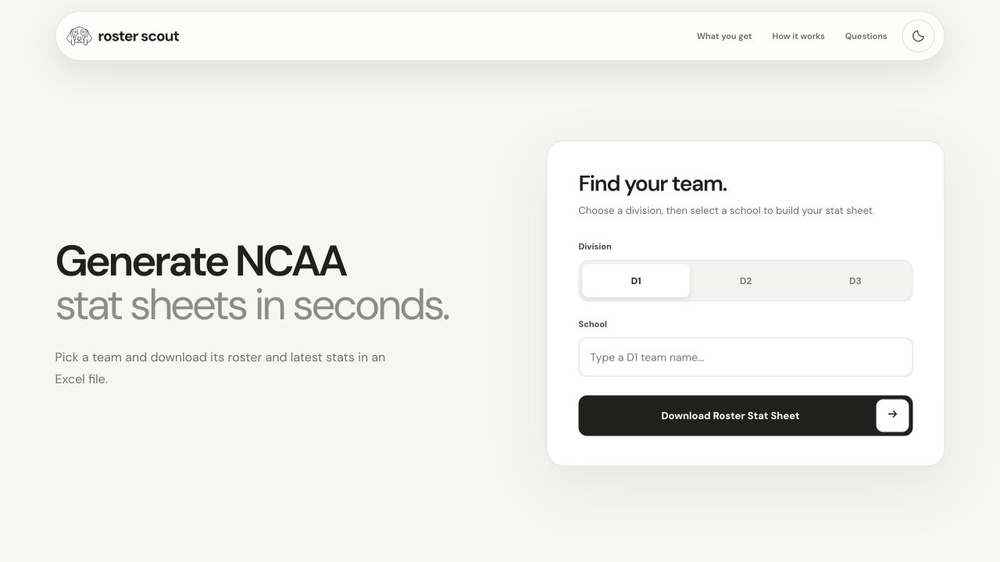
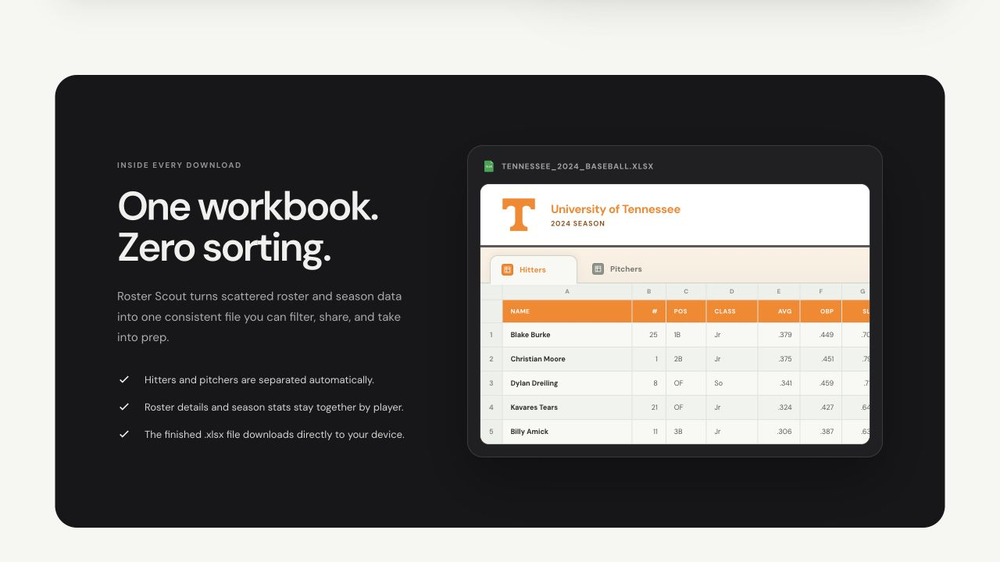
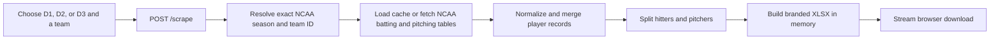

# Roster Scout

[](https://github.com/jakedaltrui/roster-scout/actions/workflows/ci.yml)
[](https://www.python.org/)
[](https://flask.palletsprojects.com/)
[](LICENSE)

Roster Scout turns a current NCAA baseball team into a polished, downloadable Excel workbook. It resolves an exact team and season, gathers roster and statistics data, normalizes inconsistent sources, separates hitters from pitchers, and generates a branded `.xlsx` file in memory.

**[Try the live app](https://roster-scout.fly.dev/)**

[](https://roster-scout.fly.dev/demo)

**[▶ Watch the 20-second product demo](https://roster-scout.fly.dev/demo)**

## Why this project is interesting

This is a compact production web app with unusually real boundaries: inconsistent third-party sports data, anti-bot challenges, exact team identity matching, spreadsheet generation, concurrent browser capacity, and public-endpoint abuse controls.

- Deterministic D1, D2, and D3 team selection backed by exact season/team IDs
- NCAA scraping with normalized player records across D1, D2, and D3
- In-memory Excel generation with separate hitter and pitcher worksheets
- School-aware workbook branding, number formats, filters, frozen headers, and print layout
- Accessible responsive UI with keyboard navigation, dark mode, progress states, and an interactive workbook preview
- Persistent successful-result caching, per-client rate limits, and process-safe Browserless session limits
- Docker and Fly.io deployment assets with a non-root runtime and health checks
- Deterministic fixture-based tests that do not depend on live NCAA availability



## How it works



The browser never receives raw scraped HTML or credentials. `app.py` owns validation and delivery, `roster_scraper.py` owns source adapters and normalization, and XlsxWriter creates the final workbook without a temporary output file.

## Local setup

Requirements: Python 3.12+ and a Browserless token for reliable live NCAA requests.

```bash
git clone https://github.com/jakedaltrui/roster-scout.git
cd roster-scout
./scripts/setup_local.sh
./scripts/set_browserless_token.sh
./scripts/run_local.sh
```

Open [http://localhost:5050](http://localhost:5050). The token prompt is hidden and writes to `.browserless-token`, which is excluded from Git and Docker build contexts.

For a standard virtual environment instead:

```bash
python3 -m venv .venv
. .venv/bin/activate
python -m pip install -r requirements.txt
python app.py
```

Live upstream behavior can change or require browser verification. The test suite stays local and deterministic.

## Verification

```bash
python -m py_compile app.py roster_scraper.py scripts/live_ncaa_smoke.py scripts/validate_ncaa_catalog.py
python -m unittest discover -s tests -v
python scripts/validate_ncaa_catalog.py
git diff --check
```

The CI workflow runs compilation, all unit tests, catalog validation, and a dependency vulnerability audit on every push and pull request.

## Security design

- Request bodies are JSON-only, size-limited, type-checked, and length-bounded.
- Team IDs are resolved against the maintained NCAA catalog rather than accepted as arbitrary URLs.
- Outbound requests use fixed hosts and explicit timeouts; the public API does not expose a general-purpose fetch primitive.
- Unexpected exceptions are logged server-side and replaced with generic client responses.
- Workbook strings cannot become formulas or automatic hyperlinks.
- Browser responses include CSP, clickjacking, MIME-sniffing, referrer, permissions, and cross-origin protections.
- Credentials, browser profiles, generated workbooks, caches, and local databases are ignored by Git and excluded from Docker builds.
- The container drops root privileges before serving requests.

See [SECURITY.md](SECURITY.md) for reporting and deployment guidance.

## Repository map

| Path | Responsibility |
|---|---|
| `app.py` | Flask routes, input validation, security headers, rate-limit integration, and workbook delivery |
| `roster_scraper.py` | Team catalog, data-source adapters, normalization, caching, and player classification |
| `usage_limits.py` | SQLite-backed request limits and process-safe Browserless capacity |
| `templates/` | Responsive product UI, unlisted demo page, and the `/scrape` client contract |
| `tests/` | Route, workbook, parsing, proxy-safety, cache, and catalog regression tests |
| `data/` | Reviewed NCAA school aliases and public school identity metadata |
| `Dockerfile`, `compose.yaml`, `fly.toml` | Reproducible local and hosted deployment |
| `CONTEXT.md` | Runtime boundaries and change-impact map |

Deployment details and environment variables live in [DEPLOYMENT.md](DEPLOYMENT.md).

## Data and trademark note

Roster Scout reads publicly available team and season statistics and caches only successfully parsed results. Upstream availability and site policies remain external dependencies. NCAA and school names and marks belong to their respective owners and are used only to identify the selected team; this project is not affiliated with or endorsed by the NCAA or any school.

## License

Source code is available under the [MIT License](LICENSE). Brand artwork and third-party school marks remain subject to their respective owners' rights.
